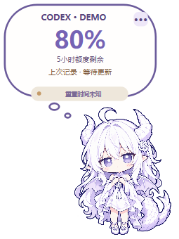

# 霜铃 · Codex 额度挂件

白发紫瞳的小龙娘，显示自己账号的 Codex 套餐剩余额度。Windows 透明桌面挂件，支持主窗口自动跟随、拖动吸附、50%～200% 缩放。独立运行，不修改 Codex/ChatGPT 程序文件。非 OpenAI 官方产品。



## 普通用户

从 [GitHub Releases 下载](https://github.com/CAOH1024/guajian/releases/latest) `ShuanglingQuota-1.1.1-Setup.exe`，双击安装。也可下载 `ShuanglingQuota-1.1.1-windows-x64.zip`，**完整解压**后双击 `ShuanglingQuota.exe`。无需另装 Python。便携版不能只复制 EXE，必须保留旁边的 `runtime` 目录。

系统：Windows 10/11 x64、.NET Framework 4.8。还需要安装官方 Codex CLI，并用自己的 ChatGPT 账号完成 `codex login`。找不到 CLI 时，在挂件右键 → 额度详情 → 选择 `codex.exe`。发行包不包含任何账号登录信息。

- **开关跟随**：安装时可勾选，或右键 →「跟随 Codex / ChatGPT 启停」。未选择时只手动运行，不自动改登录启动配置。
- **自动关闭**：最后一个 Codex/ChatGPT 主窗口关闭或隐藏到托盘后，约5～8秒退出挂件；最小化时保留。如果两个应用都有主窗口，关闭其中一个时继续跟随另一个。轻量监视器留在后台等待再次打开。
- **大小**：气泡右上角 `···` → 滑块，或在挂件上滚动鼠标滚轮；范围50%～200%，自动保存。
- **其他交互**：单击角色刷新；单击气泡切换额度窗口；拖动移动；快速连点仍有按压回弹，不弹出详情窗口；额度详情、置顶、动画和刷新频率从右键菜单进入。
- **卸载/移动**：先解除跟随，再删除/移动完整目录。安装版使用用户选择的目录，默认 `%LOCALAPPDATA%/Programs/ShuanglingQuota`，不需要管理员权限。

## 数据范围与隐私

数据来自官方 Codex CLI `app-server` 的 `account/rateLimits/read`。剩余百分比为 `100 - usedPercent`，不把未知数据伪装成0或100。读取失败保留旧值并标明等待更新。通常显示5小时和本周两个窗口，以服务实际返回为准。

**显示的是 Codex 套餐额度，不是普通 ChatGPT 各模型消息上限，也不是 API 金额余额。** 目前不单独提供普通 ChatGPT 聊天额度。

程序沿用 CLI 自己的登录，不读取浏览器 Cookie，不导出认证文件，不需要 API Key，不生成模型对话。外观与最后额度快照写入本机 `runtime/state/`。进程/窗口检测只读取元数据，不读取窗口内容。没有遥测或自动更新。

启用跟随时注册当前用户登录计划任务 `ShuanglingQuotaWatcher-<SID>`，不可用时回退到当前用户 Run 项。关闭跟随只删除本挂件自己的任务/启动项。

## 源码运行与构建

源码 MIT，第三方库使用各自许可证，角色素材范围见 [assets/LICENSE.md](assets/LICENSE.md)。源码包不包含你的账号、状态文件或机器路径。

Windows x64，推荐使用独立虚拟环境；本地发行包实际验证的 Python 版本见 `BUILD-INFO.json`。

```powershell
python -m venv .venv
.\.venv\Scripts\python -m pip install -r requirements-build.txt
.\.venv\Scripts\python -m unittest discover -s tests -v
.\.venv\Scripts\python src/launcher.py
.\.venv\Scripts\python scripts/build_release.py
```

构建脚本生成便携ZIP、安装EXE、源码ZIP、SHA256和文件清单。EXE 使用 Windows 自带的 .NET Framework C# 编译器，运行时使用原版 Python 和独立 Qt DLL；不使用 PyInstaller 自解包启动器。GitHub Actions 使用 Python 3.12 构建并验证安装包；主分支更新 `VERSION` 时自动发布新版本，也可手动触发。已有同名版本不会自动覆盖。

新 EXE 没有代码签名证书，Windows 可能显示未知发布者或 SmartScreen 提示；目前不声称适用于所有杀毒软件。请保留防护设置，校验文件来源与 SHA256。已有代码签名证书的维护者可自行签名后发布。

## 项目文件

- `src/`：Python 窗口、额度读取与自动启停。
- `windows/`：EXE 启动器与安装器的完整 C# 源码。
- `scripts/build_release.py`：可复现的打包流程，无本机硬编码路径。
- `tests/`：额度解析、通信、主窗口生命周期、颜色与缩放回归测试。
- `assets/`：角色图片、图标、生成提示词与素材说明。
- `THIRD_PARTY.md`、`licenses/`：第三方声明、许可证与对应源码位置。

界面概念参考 [DeepSeek-Balance-Whale-Widget](https://github.com/MeteorNOX/DeepSeek-Balance-Whale-Widget)。程序为独立实现，没有复制其角色素材。额度接口依据：[Codex App Server](https://learn.chatgpt.com/docs/app-server)。
